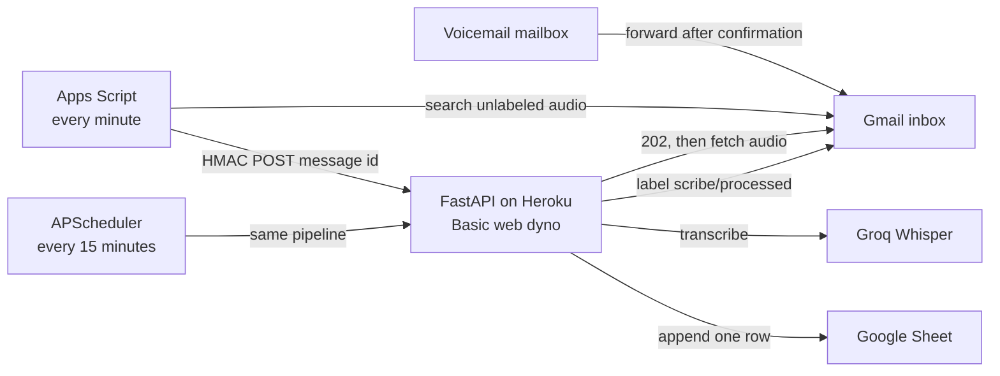

# 🎙️ Scribe

**Scribe automatically transcribes forwarded voicemail into a Google Sheet, at no cost beyond hosting.**

[](https://github.com/julianthant/scribe/actions/workflows/ci.yml)
[](LICENSE.md)

## 🌟 Highlights

- **Forward and forget.** Outlook or any other mailbox forwards voicemail emails with `.mp3`/`.wav` attachments to a dedicated Gmail inbox, and a transcript row appears in a Google Sheet about a minute later.
- **Webhook driven, no billing account.** A Google Apps Script polls every minute and sends an HMAC-signed webhook. Gmail Pub/Sub and Google Cloud billing are not needed.
- **Free transcription.** It uses Groq `whisper-large-v3-turbo` on the free tier, with an optional local `faster-whisper` fallback.
- **Idempotent.** The Sheet's `message_id` column deduplicates rows, a `scribe/processed` Gmail label marks finished messages, and a 15-minute in-app backup poll catches anything the webhook missed.
- **Small and tested.** FastAPI on a single Heroku Basic dyno, with a pytest suite that mocks Gmail, Sheets, and Groq.

## ℹ️ Overview

Voicemail systems usually email audio files, and nobody wants to listen to them one by one. Scribe turns each attachment into one searchable spreadsheet row: sender, subject, duration, transcript, and model.

Here's how it works. The voicemail mailbox forwards messages to a Gmail inbox owned by Scribe. An Apps Script in that inbox runs every minute and finds unprocessed audio messages. It POSTs only the Gmail message id to the FastAPI service's `/gmail/notifications`. The service fetches the audio through the Gmail API, transcribes it with Groq, appends a row to the Sheet, and labels the email `scribe/processed`.

Built by [Julian (Hein Thant Zaw)](https://github.com/julianthant).

## 🏗️ Architecture



The script sends only a message id. Audio stays in Gmail until the dyno downloads it. The sheet's `message_id` column is the record that survives a restart. The label `scribe/processed` is what stops the script from posting the same id again.

## 🧠 Design decisions

**Apps Script instead of Gmail Pub/Sub.** Push notifications through Pub/Sub require a Google Cloud billing account. A one-minute time trigger in the same Gmail account does not. The script searches for audio that is not labeled `scribe/processed` and POSTs `{message_id}` to `https://<app>.herokuapp.com/gmail/notifications`.

**HMAC on the raw body.** Apps Script and the dyno share `WEBHOOK_SECRET`. The script sends the hex HMAC-SHA256 of the exact JSON bytes in `X-Scribe-Signature` (an optional `sha256=` prefix is accepted). A bad signature is `401`. The body is capped at 4096 bytes, and the message id must match `^[A-Za-z0-9_-]{1,128}$`. The route returns `202` before any Gmail or transcription work, so a slow transcript cannot time the script out.

**The sheet is the source of truth.** Heroku's filesystem is wiped on restart and on every deploy, so Scribe does not keep a database. Before transcribing, the app reads column A. If that message id is already there, it applies the label and stops. Attempt counts live in process memory and reset when the dyno restarts. One web dyno only: two processes can both pass the sheet check and append twice.

**Retries, then a quiet label.** A missing attachment list stays pending and unlabeled, so a later poll can try again. A message with no audio is labeled and skipped. Groq and Gmail errors retry up to `MAX_ATTEMPTS` (5), with backoff starting at 2 seconds, doubling, and capped at 60 seconds. After the last failure the app still applies `scribe/processed`, so the script stops. To transcribe again, remove that label. If a row was already written and a new transcript is wanted, delete that row too.

**A backup poll inside the web process.** The script can miss a minute. APScheduler runs the same reconciliation about 15 seconds after boot, then every 15 minutes, on the web dyno. The first poll waits until the process is listening, which keeps Heroku's boot deadline. Heroku Scheduler is not used: the add-on is free, but each job is a separate one-off dyno and is billed.

**Groq first, local Whisper off.** Groq handles normal voicemail clips. `faster-whisper` is an optional extra and `LOCAL_WHISPER_ENABLED` defaults to false. A Basic dyno has 512 MB, and the Heroku build runs `uv sync --locked --no-default-groups`, so the extra is not installed there. Cells that start with `=`, `+`, `-`, or `@` are prefixed so Sheets stores them as text.

## 🧰 Tech stack

| Piece | Choice |
| --- | --- |
| API | FastAPI, uvicorn, Python 3.12 |
| Mail and sheet | Gmail API and Google Sheets API, OAuth desktop client |
| Notifier | Google Apps Script, one-minute time trigger |
| Transcription | Groq `whisper-large-v3-turbo`; optional `faster-whisper` |
| Schedule | APScheduler `AsyncIOScheduler` in the web process |
| Host | Heroku Basic web dyno, `Procfile` on `$PORT` |
| Audio duration | mutagen, or the wav header; ffprobe when it is installed |

## ✅ Prerequisites

- Python 3.12 (`.python-version`; `pyproject.toml` allows >=3.11) and [uv](https://docs.astral.sh/uv/)
- A dedicated Gmail account for the Scribe inbox
- A free [Groq](https://console.groq.com/keys) API key
- A [Heroku](https://www.heroku.com/) account and the Heroku CLI, for hosting

## ⬇️ Setup and deployment

Sign in as `<scribe-inbox>@gmail.com` for the Cloud project, the sheet, Apps Script, and `scribe-login`. The Gmail API calls `/users/me`, so that account is the mailbox Scribe reads.

### Google Cloud OAuth

1. Open [Google Cloud Console](https://console.cloud.google.com/) as `<scribe-inbox>@gmail.com` and create a project named `Scribe`. Dismiss any prompt to link a billing account.
2. Enable **Gmail API** and **Google Sheets API**. Do not enable Cloud Pub/Sub.
3. On the OAuth consent screen, choose **External**. App name `Scribe`. Support email and developer contact: `<scribe-inbox>@gmail.com`. Add the scopes `https://www.googleapis.com/auth/gmail.modify` and `https://www.googleapis.com/auth/spreadsheets`.
4. Publish the app so the status is **In production**. `gmail.modify` is a restricted scope, so Google shows an unverified-app warning. Choose **Advanced**, then **Go to Scribe**. An unverified production app can be granted by about 100 users, which covers this mailbox, and the refresh token is not the 7-day Testing token. Do not submit restricted-scope verification.
5. Create an OAuth client of type **Desktop app**. Desktop clients accept the loopback redirect `http://127.0.0.1:8765/` without registering it.

If Google will not show the consent screen after publishing, switch the audience back to **Testing**, add `<scribe-inbox>@gmail.com` as a test user, and run `scribe-login` again every 7 days. Production is the setup that keeps the refresh token.

### Google Sheet

Create a blank sheet at [sheets.google.com](https://sheets.google.com) while signed in as `<scribe-inbox>@gmail.com`. Leave the first tab named `Sheet1`. The spreadsheet id is the URL segment after `/d/`:

`https://docs.google.com/spreadsheets/d/<this-part>/edit`

Scribe writes this header on the first append:

`message_id`, `received_time`, `sender`, `subject`, `attachment_name`, `duration_seconds`, `transcript`, `model`, `processed_at`

### Groq

Create a key at [console.groq.com/keys](https://console.groq.com/keys). The free tier for `whisper-large-v3-turbo` allows 20 requests per minute, 2,000 requests per day, 7,200 seconds of audio per hour, and 25 MB per request.

### Heroku

Install the [Heroku CLI](https://devcenter.heroku.com/articles/heroku-cli). A Basic dyno does not sleep, so the Apps Script POST can land. It bills about $0.01 per hour, capped near $7 per month. GitHub Student Pack credit covers that while the credit lasts. Eco dynos sleep, and a sleeping dyno drops the webhook.

```bash
heroku login
heroku create <app> --stack heroku-24
heroku ps:resize web=basic
heroku ps:scale web=1
```

In the Heroku dashboard, open **Deploy**, choose **GitHub**, connect your fork of this repository, and deploy `main`. Keep a single web dyno, and set `heroku config:set WEB_CONCURRENCY=1 --app <app>` so uvicorn runs one worker. Otherwise each worker starts its own backup scheduler and the poll can append duplicate rows. The `Procfile` is:

```
web: uvicorn app.main:app --host 0.0.0.0 --port $PORT
```

`.python-version` is `3.12`. Together with `pyproject.toml` and `uv.lock`, that selects the uv build. Optional extras, including `faster-whisper`, are not installed.

On a laptop, put the client id, client secret, and `MAILBOX_ADDRESS=<scribe-inbox>@gmail.com` in a local `.env` (copy `.env.example`). Then:

```bash
uv sync --extra dev
uv run scribe-login
```

Open the printed URL and sign in as `<scribe-inbox>@gmail.com`. On the unverified-app screen, choose **Advanced → Go to Scribe**. The command checks the Gmail profile and prints one `heroku config:set` line for `GOOGLE_REFRESH_TOKEN`. Run it, then clear the terminal scrollback. Do not commit the value. The command does not write a token file.

```bash
heroku config:set --app <app> \
  MAILBOX_ADDRESS=<scribe-inbox>@gmail.com \
  GOOGLE_CLIENT_ID='<client id>' \
  GOOGLE_CLIENT_SECRET='<client secret>' \
  GOOGLE_SHEET_ID='<sheet id>' \
  GOOGLE_SHEET_TAB=Sheet1 \
  GMAIL_LABEL=scribe/processed \
  GROQ_API_KEY='<groq key>' \
  GROQ_MODEL=whisper-large-v3-turbo \
  WEBHOOK_SECRET="$(openssl rand -hex 32)" \
  LOCAL_WHISPER_ENABLED=false \
  LOG_LEVEL=INFO
```

Deploy, then check the app:

```bash
curl https://<app>.herokuapp.com/health
```

The response is `{"status":"ok","mailbox":"<scribe-inbox>@gmail.com"}`.

Access tokens stay in memory. If Google replaces the refresh token, the log says a replacement credential is held until restart and does not print it. Run `scribe-login` again, update `GOOGLE_REFRESH_TOKEN`, and restart the dyno.

### Apps Script

Follow [apps-script/README.md](apps-script/README.md). Paste `apps-script/Code.gs` and `apps-script/appsscript.json` into a new project on `<scribe-inbox>@gmail.com`.

| Script property | Value |
| --- | --- |
| `WEBHOOK_URL` | `https://<app>.herokuapp.com/gmail/notifications` |
| `WEBHOOK_SECRET` | `heroku config:get WEBHOOK_SECRET --app <app>` |

Run `scribePoll` once and approve access. Run `installTrigger` once. That creates the one-minute trigger. Do not link a billing account to the script project.

### Forwarding

On the mailbox that receives the voicemail:

1. Add a forwarding address for `<scribe-inbox>@gmail.com`.
2. Open the confirmation message in the Scribe inbox and accept it. Forwarding does not start until that verification is done.
3. Create a filter for the voicemail (attachment, or the subject your phone system uses) and forward it to the Scribe inbox. Leave a copy in the source mailbox.

A campus Google Workspace tenant often blocks forwarding to an external address. If adding the address fails, an admin has to allow it.

Send a test `.mp3` or `.wav` to the Scribe inbox. Within about a minute one row appears and the message gains `scribe/processed`. The same Gmail message must not add a second row.

## ⚙️ Configuration

Copy `.env.example` for local login. Heroku stores the same names as config vars. Empty secrets in the example file are intentional.

| Variable | Required | Default | Purpose |
| --- | --- | --- | --- |
| `MAILBOX_ADDRESS` | yes | | Gmail inbox that receives the voicemail. Example: `<scribe-inbox>@gmail.com` |
| `GOOGLE_CLIENT_ID` | yes | | OAuth desktop client id |
| `GOOGLE_CLIENT_SECRET` | yes | | OAuth desktop client secret |
| `GOOGLE_REFRESH_TOKEN` | yes, at runtime | | Printed by `scribe-login`. Not written to disk |
| `GOOGLE_SHEET_ID` | yes | | Spreadsheet id from the sheet URL |
| `GOOGLE_SHEET_TAB` | | `Sheet1` | Tab name, one token, no spaces |
| `GMAIL_LABEL` | | `scribe/processed` | Label applied when a message is finished or given up |
| `WEBHOOK_SECRET` | yes, for the server | | HMAC secret, 16 to 128 characters. `openssl rand -hex 32` |
| `GROQ_API_KEY` | yes | | Groq API key |
| `GROQ_MODEL` | | `whisper-large-v3-turbo` | Groq transcription model |
| `LOCAL_WHISPER_ENABLED` | | `false` | Local fallback. Leave false on Heroku |
| `WHISPER_MODEL` | | `small` | Model name when the local extra is installed |
| `WHISPER_MODEL_DIR` | | `data/models` | Download directory for the local model |
| `SCRIBE_OAUTH_HOST` | | `127.0.0.1` | `scribe-login` bind address. `0.0.0.0` is the other allowed value |
| `SCRIBE_OAUTH_PORT` | | `8765` | Loopback port for the OAuth redirect |
| `RECONCILE_INTERVAL_SECONDS` | | `900` | Backup poll interval. Minimum 60 |
| `RECONCILE_LOOKBACK_HOURS` | | `48` | How far back the poll searches |
| `MAX_ATTEMPTS` | | `5` | Failures before the message is labeled and left alone |
| `RETRY_BACKOFF_SECONDS` | | `2` | First retry delay. Later delays double, up to 60 seconds |
| `LOG_LEVEL` | | `INFO` | Python log level |
| `WEB_CONCURRENCY` | recommended on Heroku | | Read by uvicorn, not by Scribe's settings. Set it to `1` so there is a single worker and a single backup scheduler |

Logs include message ids, models, and durations. They do not include transcripts, refresh tokens, or the webhook secret.

## 🧪 Testing

```bash
uv sync --extra dev
uv run ruff check
uv run ruff format --check
uv run pytest
```

Tests mock Gmail, Sheets, and Groq. They cover the HMAC webhook, sheet dedup, formula prefixes, Gmail parsing, retries, the in-memory token cache, and config errors. `uv run python -m app.poll` runs one reconciliation and exits. On Heroku that command is a billed one-off dyno; the in-process timer is the path that stays on the web dyno.

`.github/workflows/reconcile.yml` is manual (`workflow_dispatch` only). Leave it unused while the dyno is running, because two writers can both append before either sees the new row.

To try local Whisper on a laptop, install the extra and turn it on. That extra is not part of the Heroku slug.

```bash
uv sync --extra dev --extra local
```

## 📁 Project structure

```
apps-script/        Apps Script notifier (Code.gs, appsscript.json, install guide)
src/app/api/        HMAC-verified webhook route (/gmail/notifications)
src/app/auth/       OAuth scopes, token provider, scribe-login CLI
src/app/core/       Settings (env vars) and logging
src/app/google/     Gmail and Sheets API client and message parsing
src/app/pipeline/   Audio handling, transcription, sheet writes, reconcile, retry state
src/app/services/   Background worker and APScheduler backup poll
src/app/main.py     FastAPI app and /health
src/app/poll.py     One-shot reconcile (scribe-poll)
tests/              pytest suite
Procfile, app.json  Heroku config
```

## ⚠️ Limitations

- A Basic dyno is paid (about $7 per month at the cap). Student Pack credit pays it only while the credit lasts. The dyno must stay up for the webhook to succeed.
- Attempt counts disappear on restart. A message that failed four times starts again at one after a deploy, unless it was already labeled or already has a sheet row.
- Clips larger than 24 MB need ffmpeg to be split for Groq. The Heroku slug does not include ffmpeg. Voicemail clips are smaller than that.
- The unverified Gmail scope shows a consent warning and is capped at about 100 users. This app is for one mailbox.
- The sheet append is not locked across processes. Scale the web formation to 1 and set `WEB_CONCURRENCY=1`.
- If Google replaces the refresh token, the new value lives only until the dyno restarts. Update the config var by hand.
- The backup poll and the script can both see a message before the label exists. The sheet check makes the second pass a no-op when the first pass finished the row.

## 💭 Contributing

Issues and pull requests are welcome. See [CONTRIBUTING.md](CONTRIBUTING.md) and the [Code of Conduct](CODE_OF_CONDUCT.md).

## 📄 License

MIT. See [LICENSE.md](LICENSE.md).
